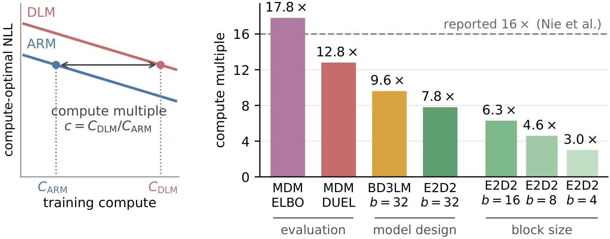

# Revisiting the 16× Pretraining Compute Gap between Diffusion and Autoregressive Language Models

[](https://guanghanwang.com/dlm-scaling)
[](LICENSE)

**TL;DR: the widely cited 16× compute gap between diffusion and autoregressive language models
largely reflects an outdated scaling-law protocol. Under current practice, the gap falls to
between 3× and 8×.**

<p align="center">
  
</p>

**Left:** the compute multiple *c* = *C*<sub>DLM</sub>/*C*<sub>ARM</sub> measures how many times
more training compute a diffusion language model (DLM) needs than an autoregressive model (ARM)
to reach the same compute-optimal negative log-likelihood (NLL). **Right:** *c* as the
evaluation (ELBO → DUEL), the model design (MDM → BD3LM → E2D2) and the block size are revised.

This repository is the code release behind the paper *Revisiting the 16× Pretraining Compute
Gap between Diffusion and Autoregressive Language Models*. Our contribution can be summarized
as follows:

* We revisit the scaling laws of DLMs under a protocol that reflects current practice: exact
  likelihood evaluation, block diffusion, an encoder–decoder architecture, and a sweep over the
  block sizes used in practice.
* Pretraining DLMs is far cheaper than previously assumed. Exact likelihood evaluation reduces
  the compute multiple to 12.8×; block diffusion with an encoder–decoder architecture reduces it
  to 7.8× at block size 32; and smaller blocks narrow it to 4.6× at block size 8 and 3.0× at
  block size 4.
* We find a simple empirical rule for the optimal decoder depth of encoder–decoder block
  diffusion, which depends on the block size alone; the gap between variants persists at a
  held-out budget three times larger than our largest fitted one; and likelihood improvements
  carry over to downstream benchmark accuracy.

> **Reproducibility note.** This code is being released solely for academic and scientific
> reproducibility purposes, in support of the methods and findings described in the associated
> publication. Pull requests are not being accepted in order to maintain the code exactly as it
> was used in the paper.

## What Is Here

We include the scaling law analysis and benchmark evaluation code for ARM, MDM, BD3LM, and
E2D2.

| family | model | trainer | evaluator |
|---|---|---|---|
| ARM | `lit_gpt/model.py` (`GPT`) | `pretrain/train_ar.py` | `eval/evaluate_ar.py` |
| MDM | `lit_gpt/diffmodel.py` (`TransEncoder`) | `pretrain/train_mdm.py` | `eval/evaluate_mdm.py` |
| BD3LM | `lit_gpt/bd3lm_model.py` (`BD3LM`) | `pretrain/train_bd3lm.py` | `eval/evaluate_bd3lm.py` |
| E2D2 | `lit_gpt/e2d2_model.py` (`E2D2Model`) | `pretrain/train_e2d2.py` | `eval/evaluate_e2d2.py` |

## Environment Setup

Every model in the paper was trained and evaluated with PyTorch 2.4.1 on CUDA 12.1, and the
code additionally needs Flash Attention 2.6.3 together with its `rotary`, `layer_norm` and
`xentropy` CUDA extensions, xFormers 0.0.28, and lm-evaluation-harness 0.4.4. There are three
equivalent ways to get that environment. The first is to build the image we used for all of
the runs:

```sh
docker build -t dlm-scaling .
```

The second is to recreate the frozen conda environment of that image:

```sh
conda env create -f environment.yaml
```

If you would rather install the dependencies one by one, [CONDA.md](CONDA.md) walks through the
same environment step by step.

## Data

All models are trained on SlimPajama. The preprocessing script streams the dataset from
HuggingFace, tokenizes it with the TinyLlama sentencepiece tokenizer, and packs the result into
binary chunks of 2049 × 1024 tokens:

```sh
python scripts/prepare_slimpajama.py --split train      --destination data/slim_star_combined
python scripts/prepare_slimpajama.py --split validation --destination data/slim_star_combined
```

The trainers look for those chunks in `data/slim_star_combined` unless `DATA_DIR` points
somewhere else. Following TinyLlama, the GitHub and code subset is dropped from every split.

## Pretraining

A run is fully specified by the model size it trains (`--model`) and the compute budget it
spends (`--flops`, in units of 10¹⁸ FLOPs). The budget is counted in real training FLOPs, using
the per-variant formulas in `lit_gpt/flops.py` rather than the 6*ND* approximation, so the same
`--flops` value means the same amount of compute across all four families.

Everything else is held fixed across the study. Each run occupies one node of 8 GPUs and sees a
global batch of 256 × 2048 tokens. The optimizer is AdamW with β = 0.9/0.95, a weight decay of
0.1 and gradients clipped at 1.0, and the learning rate warms up linearly over 1% of the steps
(at least 100 of them) to a peak of 4e-4 before decaying on a cosine schedule to a tenth of
that peak. Every diffusion variant is trained with the low-variance loss, which `--low_var_loss`
selects.

```sh
# ARM, 944M parameters at C = 1e20 FLOPs
lightning run model --node-rank=0 --accelerator=cuda --devices=8 --num-nodes=1 \
    pretrain/train_ar.py --model 944 --flops 100.

# MDM, 944M at C = 1e20
lightning run model --node-rank=0 --accelerator=cuda --devices=8 --num-nodes=1 \
    pretrain/train_mdm.py --model 944 --flops 100. --low_var_loss

# BD3LM, 142M at C = 1e19, block size b = 4
lightning run model --node-rank=0 --accelerator=cuda --devices=8 --num-nodes=1 \
    pretrain/train_bd3lm.py --model 142 --flops 10. --mtp_window 4 --low_var_loss

# E2D2, 472M at C = 1e20, block size b = 32, 14 decoder layers
lightning run model --node-rank=0 --accelerator=cuda --devices=8 --num-nodes=1 \
    pretrain/train_e2d2.py --model 472 --flops 100. --mtp_window 32 --n_dec_layers 14 \
    --low_var_loss
```

When training finishes, each script scores the validation set and logs the readouts that the
scaling laws are fitted on. `metric/val_loss` is the exact NLL for the ARM and the ELBO for the
diffusion variants, and the diffusion variants additionally log `metric/duel_nll`, the exact
likelihood of the validation data under the model's own greedy top-1-confidence decoding order.
The validation set is frozen at 6144 sequences per rank so that every run is scored on the same
tokens. Because validation is sharded by rank, a different world size would score different
tokens, which is why the trainers assert `--nodes_num 1`.

To reproduce one IsoFLOP curve, hold `--flops` fixed and sweep `--model` over 7–10 sizes
around the compute-optimal size for that budget, then fit a parabola in log₁₀ *N* to the
resulting NLLs and read off its vertex. Please refer to the paper for the details of the
IsoFLOP grids.

## Evaluation

Training saves a full Fabric state, which is a `.pth` file containing the optimizer moments
alongside the weights, whereas the evaluators expect a bare `.safetensors` state dict. A
checkpoint therefore has to be converted before it can be evaluated:

```sh
python scripts/pth_to_safetensors.py \
    --in  workdir/e2d2-472M-14dec-w32-100.0flop-lowvar/iter-048715-ckpt.pth \
    --out workdir/e2d2-472M-14dec-w32-100.0flop-lowvar/iter-048715-ckpt.safetensors \
    --model 472 --arch e2d2 --n_dec_layers 14
```

Passing `--arch` (one of `ar`, `mdm`, `bd3lm` and `e2d2`) makes the converter build the target
module and compare its key set against the one it produced, so an architecture that does not
match the weights fails at conversion time rather than mis-loading hours into an evaluation.

Zero-shot accuracy on the eleven lm-evaluation-harness benchmarks then comes from the four
scripts in `eval/scripts/`, one per family, which record the exact commands the paper's numbers
were produced with:

```sh
bash eval/scripts/eval_arm.sh      # exact NLL (one scorer)
bash eval/scripts/eval_mdm.sh      # DUEL + 128-sample MC ELBO
bash eval/scripts/eval_bd3lm.sh    # DUEL + 128-sample MC ELBO
bash eval/scripts/eval_e2d2.sh     # DUEL + 128-sample MC ELBO
```

The paper reports the mean over eight of these eleven benchmarks, namely HellaSwag, ARC-easy,
PIQA, SciQ, RACE, SIQA, OpenBookQA and LAMBADA. WinoGrande, BoolQ and COPA are excluded because
models at these scales perform indistinguishably from chance on them.

## Security

See [CONTRIBUTING](CONTRIBUTING.md#security-issue-notifications) for more information.

## License

This code is released under [CC BY-NC 4.0](LICENSE) (non-commercial).

Parts of it derive from third-party code: SMDM (Nie et al., 2025), TinyLlama and lit-gpt, all
of which are Apache-2.0, and nanoGPT, which is MIT. The Apache-2.0 license is retained in
[LICENSE-APACHE-2.0](LICENSE-APACHE-2.0), and [NOTICE](NOTICE) records which files come from
where, along with the licenses of the dependencies, the training data and the benchmarks.

## Citation

```bibtex
@article{wang2026revisiting,
  title   = {Revisiting the 16x Pretraining Compute Gap between Diffusion and
             Autoregressive Language Models},
  author  = {Wang, Guanghan and He, Bing and Shi, Zhan and Dumoulin, Benoit and
             Lu, Hanqing and Kuleshov, Volodymyr},
  journal = {arXiv preprint},
  year    = {2026}
}
```
